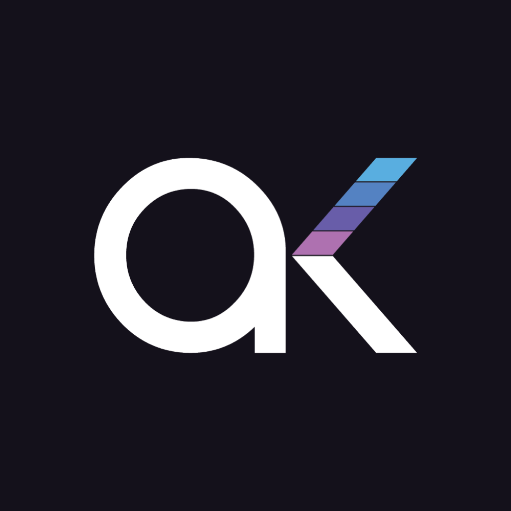

# AKCybex

**Software development · IT services · Open source · SaaS products**

We design, build and run software for businesses, and we give back to the developer community through open-source packages.

---

## 👋 Who we are

AKCybex is a software development and IT services company. We partner with startups and established businesses to take products from idea to production, and we build our own SaaS products along the way.

Everything we learn while shipping client and product work flows back into our open-source libraries, which anyone is free to use.

## 🛠️ What we do

| Area | What it covers |
| --- | --- |
| **Custom software development** | Web applications, APIs, admin panels, e-commerce storefronts and internal tools built to spec |
| **Mobile apps** | Cross-platform mobile apps with React Native and Expo |
| **IT services** | Infrastructure, DevOps, Docker-based environments, integrations and ongoing maintenance |
| **SaaS products** | Our own multi-tenant products, designed, built and operated in-house |
| **Open source** | Reusable packages for the PHP, Laravel, JavaScript and TypeScript ecosystems |

## 🧰 Our stack

## 📦 Open source

| Project | Description | Stack |
| --- | --- | --- |
| [**jstr**](https://github.com/akcybex/jstr) | A toolkit of string helpers: slugify, UUIDs, password generation, text processing and more | TypeScript |
| [**laravel-jazzcash**](https://github.com/akcybex/laravel-jazzcash) | JazzCash payment gateway integration for Laravel | PHP / Laravel |
| [**react**](https://github.com/akcybex/react) | Essential React components for React, Next.js and Gatsby apps | TypeScript / React |
| [**sail**](https://github.com/akcybex/sail) | Docker Compose files for spinning up basic application environments | Docker / Shell |
| [**php-youtube**](https://github.com/akcybex/php-youtube) | PHP helpers for working with YouTube | PHP |

Browse all of our public work in the [repositories tab](https://github.com/orgs/akcybex/repositories).

## 🤝 Contributing

We welcome issues and pull requests on all of our open-source repositories.

1. Open an issue to discuss a bug or feature before starting large changes.
2. Fork the repository and create a branch for your work.
3. Keep pull requests focused and include a clear description of what changed and why.
4. Follow the coding style already used in the repository.

Found a security issue? Please email [developers@akcybex.com](mailto:developers@akcybex.com) instead of opening a public issue.

## 📬 Get in touch

Have a project in mind, or want to talk about working together?

- 🌐 Website: [akcybex.com](https://akcybex.com)
- ✉️ Email: [developers@akcybex.com](mailto:developers@akcybex.com)

Built with care by the AKCybex team.

